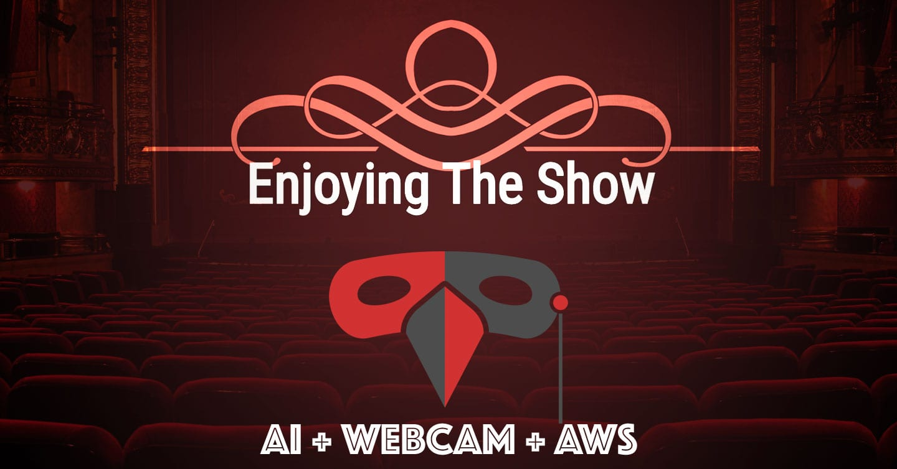

# Enjoying The Show


## Real-time AI facial expression gathering with Amplify GraphQL and TensorFlow.js

This app uses face-api to gauge your facial expression, and then sends all faces in a particular URL or (room) to a "Watch" page. The watch page summarizes all the faces to a single Victory Pie chart.

**Live at [enjoyingthe.show](https://enjoyingthe.show)** · [Watch the talk on YouTube](https://www.youtube.com/watch?v=GskMuu821NI)

## How to use it

- **Speaker:** open `https://enjoyingthe.show/watch/<room-name>` for a live pie chart of the room's mood.
- **Audience:** share `https://enjoyingthe.show/room/<room-name>`. Each person allows webcam access; expressions are detected in their browser and only the emotion word is sent.

## Stack

- React 19 + React Router, built with [Vite](https://vite.dev). The homepage is prerendered at build time (`scripts/prerender.js`) so search engines and LLM agents see real content without running JavaScript.
- [@vladmandic/face-api](https://github.com/vladmandic/face-api) (TensorFlow.js) for face detection + expressions, lazy-loaded only on `/room/*`. Model weights are served from `public/`.
- AWS AppSync GraphQL (API key auth) + DynamoDB, originally created with Amplify Gen 1 (`amplify/` holds the schema), hosted on AWS Amplify Hosting.
- `public/llms.txt`, `sitemap.xml`, JSON-LD structured data and Open Graph tags for discoverability.

## Develop

```sh
npm install
npm run dev     # http://localhost:3000
npm test
npm run build   # outputs dist/ with the prerendered homepage
```

## Deploy

Amplify Hosting builds every push to `master` using `amplify.yml` (frontend only: `npm ci && npm run build`, publishing `dist/`). The backend is already deployed and is no longer pushed from CI.

Single-page-app rewrites live in the Amplify console: everything that isn't a static file rewrites to `/index.html` (200).

### The AppSync API key

The site authenticates to AppSync with a public API key (`src/aws-exports.js`). AppSync keys expire after at most 365 days, which is what took the site down in 2023. `infra/renew-api-key.sh` installs a small Lambda plus a monthly EventBridge rule that keeps pushing the key's expiry out a year. Re-run it from AWS CloudShell any time; it is idempotent.

If the key ever does lapse, create a new one and update `src/aws-exports.js`:

```sh
aws appsync create-api-key --api-id f6gwcwcbmbazflkwwr3h6uypne \
  --expires $(( ($(date +%s) + 364*86400) / 3600 * 3600 ))
```

### Your own copy

To stand up your own backend, install the Amplify CLI (`npm i -g @aws-amplify/cli`), run `amplify init` and `amplify push` to create the AppSync API from `amplify/backend/api/facefun/schema.graphql`, then point `src/aws-exports.js` at it.


